<div align="center">


# Dealestate

**India’s First Human-Led, AI-Powered Real Estate Growth System**

*More Than Leads. A Complete Growth System.*

[](https://react.dev/)
[](https://www.typescriptlang.org/)
[](https://vitejs.dev/)
[](https://tailwindcss.com/)
[](qa-reports/PRODUCTION_READINESS_REPORT.md)
[](qa-reports/PRODUCTION_READINESS_REPORT.md)
[](qa-reports/PRODUCTION_READINESS_REPORT.md)
[](#-license)

[Project Overview](#-project-overview) • [Desktop Preview](#-desktop-preview) • [Mobile Preview](#-mobile-preview) • [Section Screenshots](#-complete-website-screenshots) • [Responsive Showcase](#-responsive-showcase) • [Interactions](#-interactive-states) • [Architecture](#-project-architecture) • [Getting Started](#-installation--setup) • [Contact](#-official-contact--business-details)

</div>

---

## 📖 Project Overview

**Dealestate** is an enterprise-grade real estate growth system engineered specifically for Indian property brokers, independent real-estate consultants, and multi-agent commercial firms. Operating under the umbrella of **Codnexa**, Dealestate eliminates the chronic pitfalls of traditional property portals: noise, duplicate broker spam, lack of follow-up bandwidth, and shared leads auctioned to 10+ brokers simultaneously.

### The Problem in Indian Real Estate
Traditional portals operate on a volume-first listing aggregation model. Brokers spend high monthly subscription fees only to receive recycled leads that have already been telephoned by dozens of competing agencies, resulting in hostile property owners, burned relationships, and wasted operational hours.

### The Dealestate Solution
Dealestate pairs **algorithmic AI screening** with a **dedicated human operations layer**:

1. **Strict 1 Client : 1 Lead Exclusivity**: Every verified property-owner lead is allocated strictly to a single broker within their target pin code or micro-market. Zero shared leads.
2. **Dedicated Human Sales Specialist Layer**: Trained real estate tele-calling specialists directly contact property owners to verify ownership documentation, confirm commercial parameters, qualify seller motivation, and secure scheduled visit slots.
3. **AI-Assisted Listing Screening**: Automated heuristics parse public listings, eliminate duplicate contact numbers, detect broker reposts, and cross-reference tax and municipal databases in real time.
4. **Three Dedicated Owner Categories**: High-intent property-owner acquisition channels across **Residential Rental**, **Residential Resale**, and **Commercial Property** sectors.

---

## 🖥️ Desktop Preview


*The complete Dealestate desktop homepage featuring the luminous Mumbai skyline hero, single-line Commercial Owner badge, interactive Lead Allocation & Screening Desk, and high-contrast design system.*

---

## 📱 Mobile Preview

<div align="center">
  
</div>

*Full mobile experience (390px viewport) verified with zero horizontal overflow, fluid responsive typography, and mobile-first touch ergonomics.*

---

## 📸 Complete Website Screenshots

Every screenshot below is freshly captured from the live rendered website at standard desktop viewport (`1440 × 900`):

### 1. Sticky Navigation Header

*High-contrast header with `#08172B` backdrop blur, crisp vector logo, active section tracking, and primary lead allocation CTA.*

### 2. Homepage Hero Section
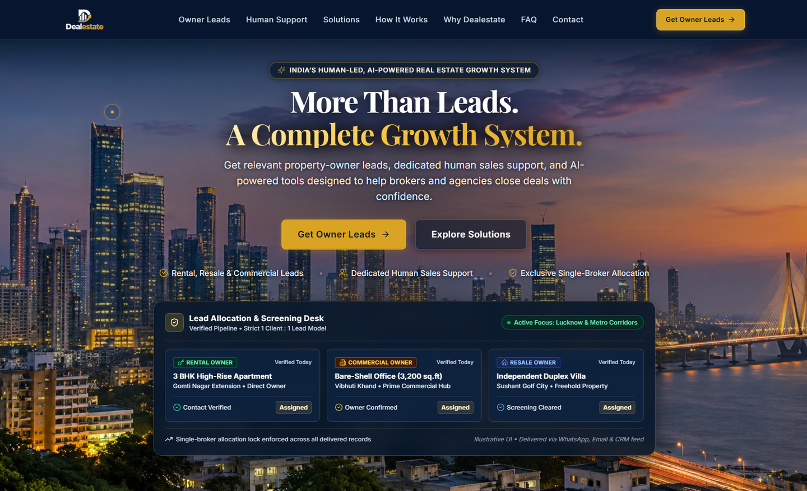
*Hero section with Mumbai skyline photography, strategic value proposition, primary action buttons, and live pipeline status.*

### 3. Lead Allocation & Screening Desk

*High-contrast operational desk preview highlighting live pipeline verification, Rental Owner, Resale Owner, and single-line Commercial Owner badges with 1:1 exclusivity pills.*

### 4. Verified Owner Leads Section

*Three comprehensive acquisition tiers: Residential Rental, Residential Resale, and Commercial Owner leads on a warm ivory surface.*

### 5. Dedicated Human Sales Support Section

*Deep navy high-impact section showcasing Dealestate's core differentiator: trained tele-calling professionals who handle qualifying calls and site-visit scheduling.*

### 6. Growth Solutions Section

*Seven specialized business solutions featuring a balanced color rhythm across Warm Ivory, Deep Navy, and Soft Blue surfaces with antique gold accents.*

### 7. How It Works (7-Stage Workflow Pipeline)

*Continuous 7-stage operational workflow (`Source ➔ Filter ➔ Screen ➔ Review ➔ Allocate ➔ Deliver ➔ Track`) with dedicated pipeline track and numbered milestones.*

### 8. Who We Serve (Client Profiles)

*Tailored operational models for Independent Luxury Brokers, Multi-Agent Brokerages, and Specialized Commercial Consultants.*

### 9. Why Dealestate (Market Differentiation)

*Side-by-side comparison between traditional mass portals and Dealestate's exclusive 1:1 model with human-in-the-loop qualification.*

### 10. Frequently Asked Questions (FAQ)

*Ten fully accessible accordion questions detailing pricing brackets, exclusivity locks, geographic rollouts, and replacement guidelines.*

### 11. Contact & Locality Allocation Hub

*Direct communication hub displaying direct phone, WhatsApp channel, email desk, operating hours, and verified social channels.*

### 12. Growth Inquiry Form

*Live lead reservation form with real-time validation, FormSubmit AJAX endpoint, loading indicators, and fallback action pills.*

### 13. Site Footer

*Footer with Codnexa attribution, sitemap navigation links, legal copyright notices, and back-to-top trigger.*

---

## 💻 Laptop Showcase (1280px)

Captured at standard laptop viewport (`1280 × 800`):

| Homepage | Hero Section |
|:---:|:---:|
|  | 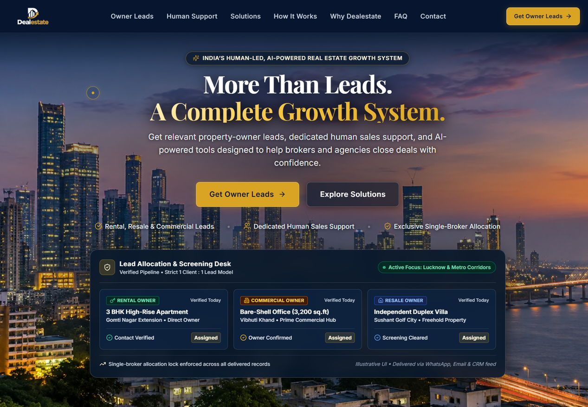 |
| *Full laptop viewport rendering* | *Luminous Mumbai skyline and CTAs* |

| Solutions Grid | How It Works Pipeline | Contact Section |
|:---:|:---:|:---:|
| 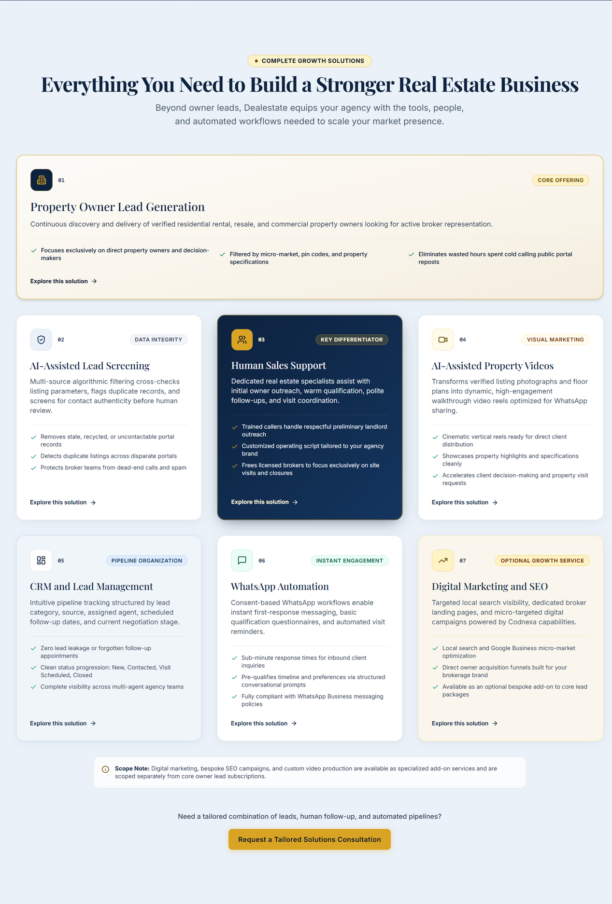 | 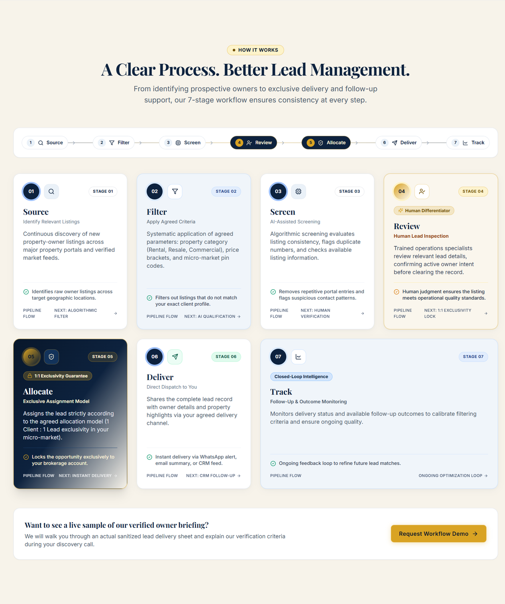 | 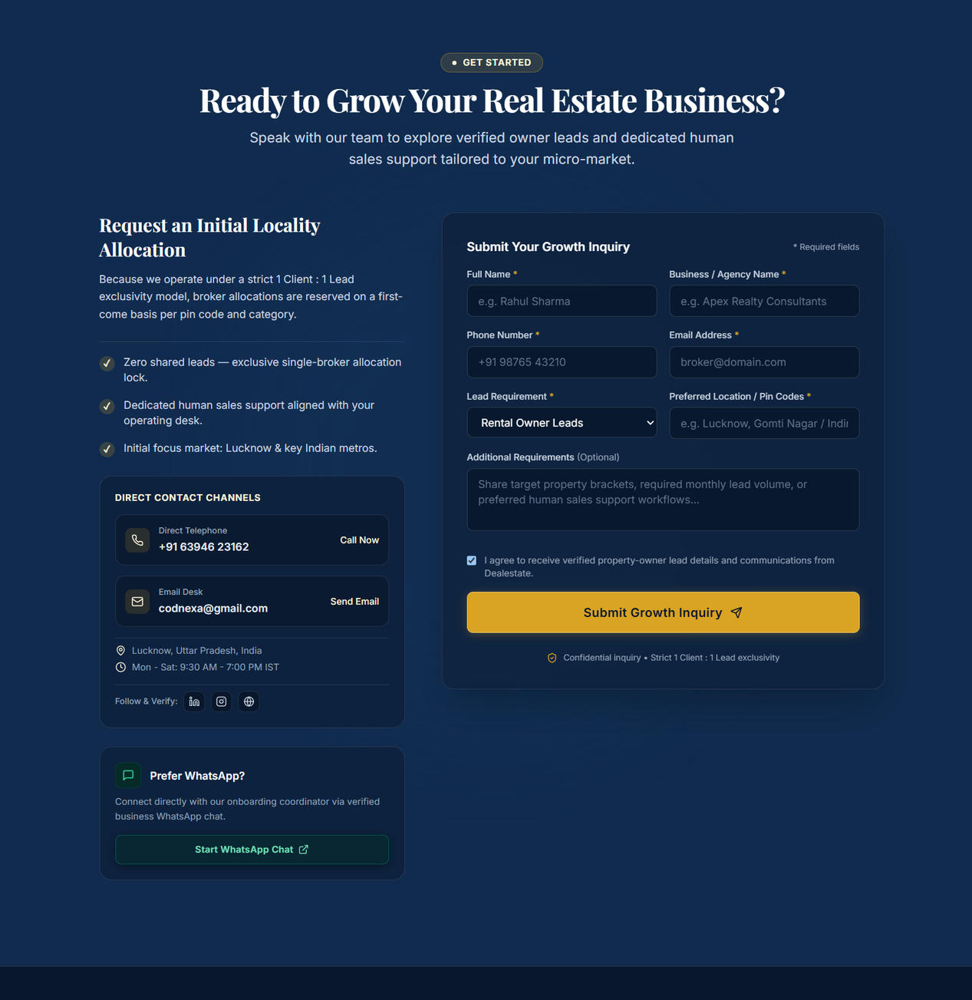 |
| *Multi-column card layout* | *7-stage operational workflow* | *Lead allocation desk form* |

---

## 📱 Tablet Showcase (768px)

Captured at standard tablet portrait viewport (`768 × 1024`):

| Tablet Navigation State | Tablet Hero Section | Tablet Owner Leads |
|:---:|:---:|:---:|
| 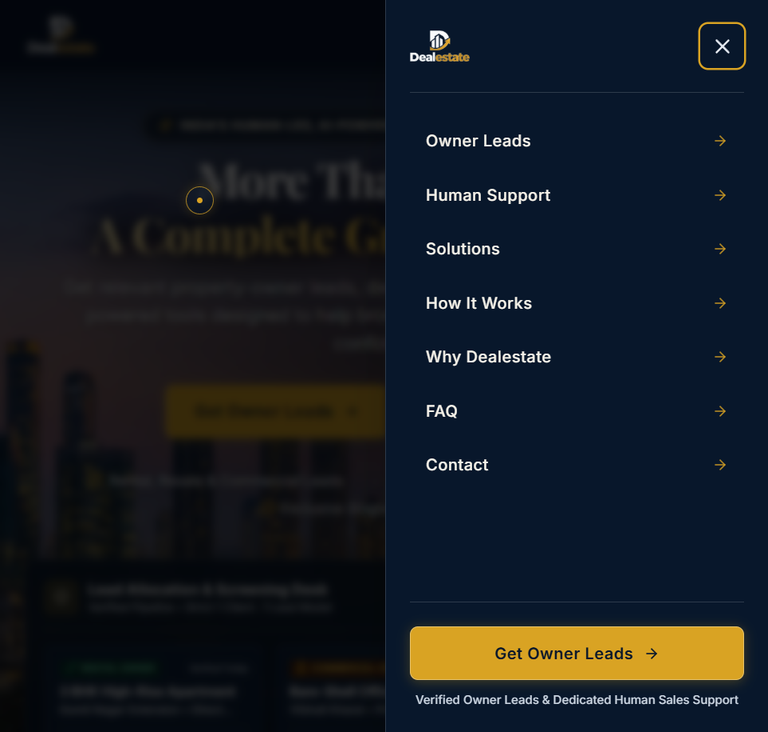 | 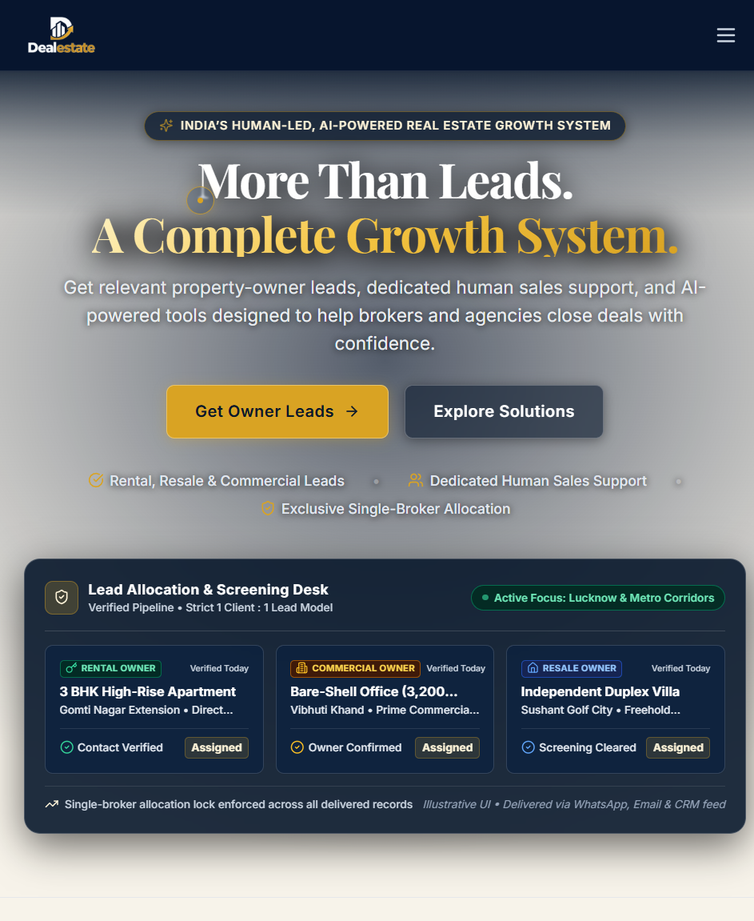 | 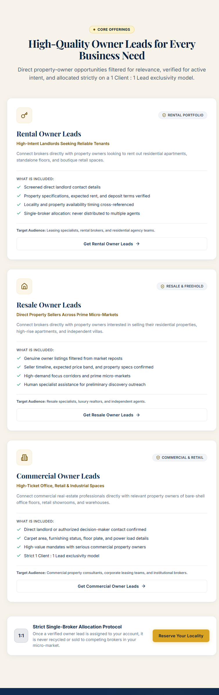 |
| *Slide-out menu with high contrast* | *Centered headline and pipeline desk* | *Vertically stacked category cards* |

| Tablet Solutions | Tablet How It Works | Tablet Contact Form |
|:---:|:---:|:---:|
| 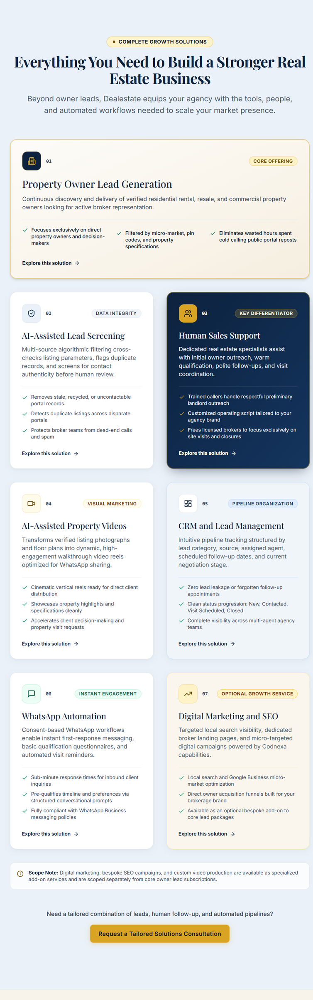 | 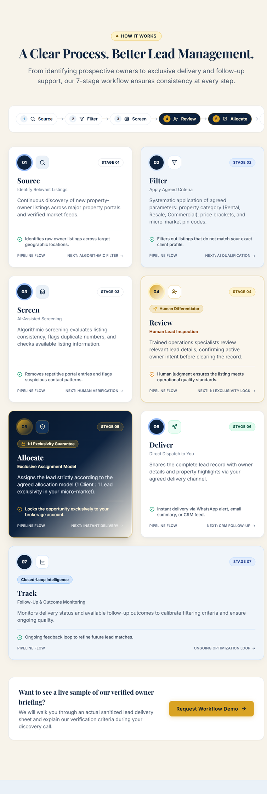 | 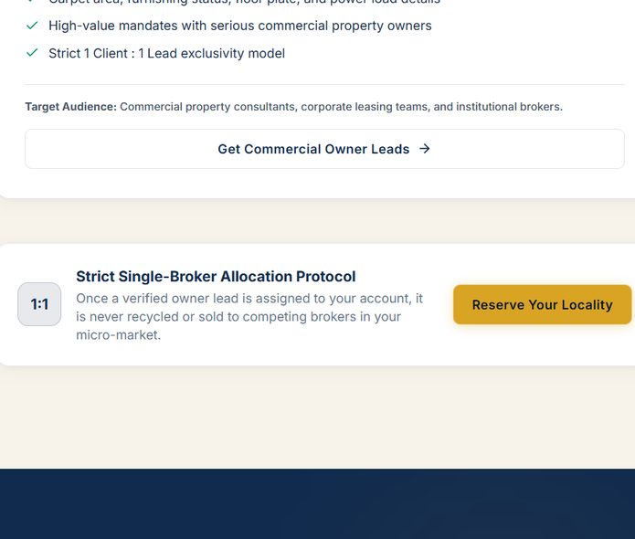 |
| *Two-column adaptive cards* | *Sequential 7-stage workflow rail* | *Full-width inquiry reservation card* |

---

## 📲 Mobile Showcase (390px, 375px, 360px)

The mobile experience was rigorously tested across common Indian smartphone widths. All touch targets meet or exceed $\ge 44\text{px}$, with zero horizontal overflow:

### Mobile Navigation Drawer (Contrast Verified)

| Mobile Sidebar CLOSED | Mobile Sidebar OPEN |
|:---:|:---:|
| 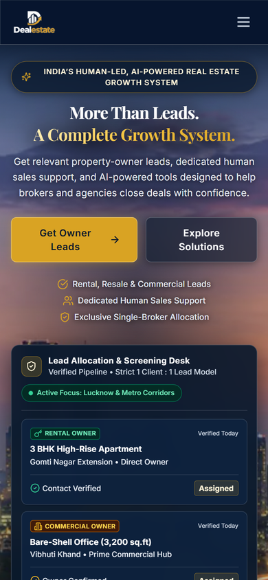 | 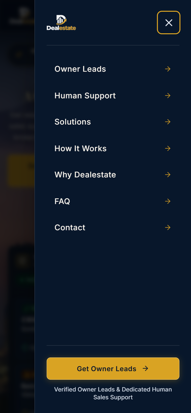 |
| *Clean navbar with hamburger toggle* | *Deep Navy `#08172B` surface, Warm Ivory text, and Gold indicators* |

> [!NOTE]
> **Mobile Sidebar Contrast Enhancement**: The mobile slide-over navigation drawer utilizes high-contrast `#F7F3EA` typography, `#D9A323` indicator chevrons, and a high-visibility close button, ensuring perfect readability in both outdoor and low-light environments.

### Core Mobile Sections

| Mobile Hero & Desk | Mobile Owner Leads | Mobile Human Support |
|:---:|:---:|:---:|
| 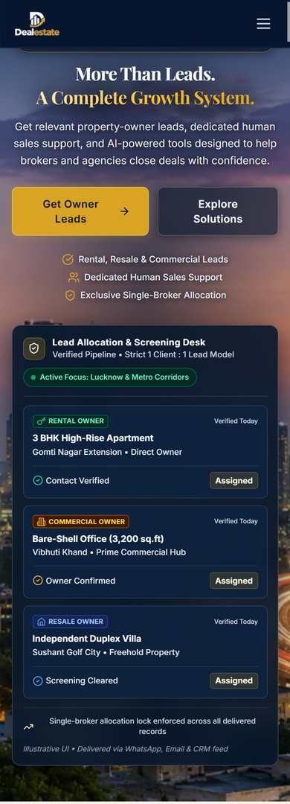 |  | 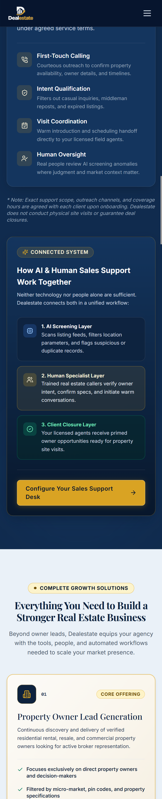 |
| *Compact headline & live desk* | *Single-column acquisition cards* | *Differentiator showcase* |

| Mobile Solutions | Mobile How It Works | Mobile Who We Serve |
|:---:|:---:|:---:|
|  |  | 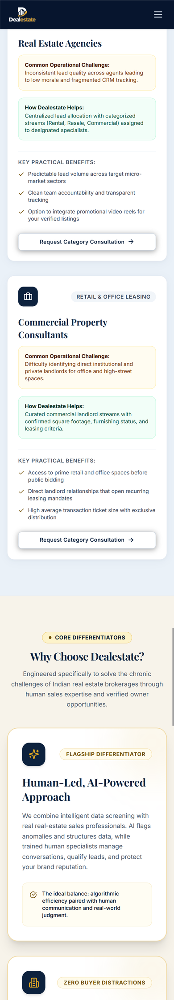 |
| *Harmonized ivory & blue cards* | *Vertical 7-stage process timeline* | *Client profile tiers* |

| Mobile Why Dealestate | Mobile FAQ | Mobile Contact Form |
|:---:|:---:|:---:|
| 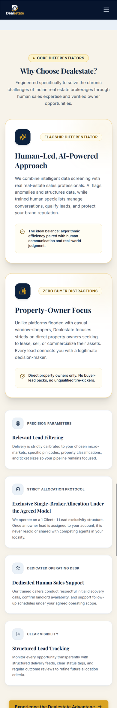 | 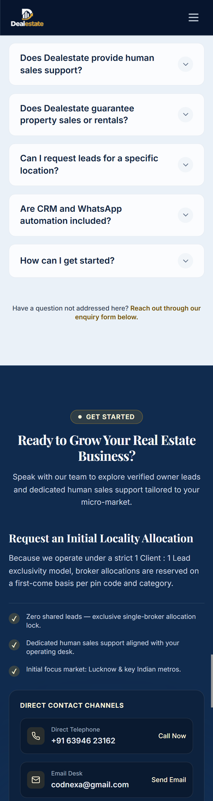 | 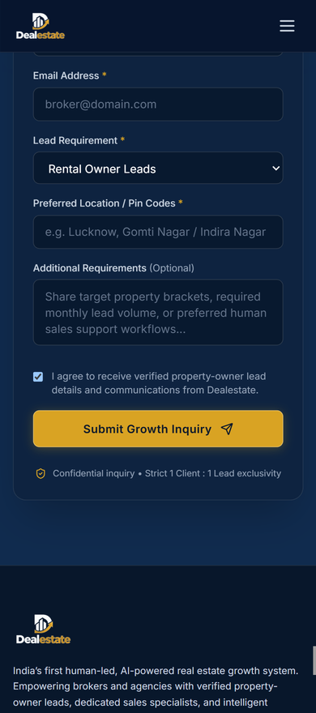 |
| *Portal comparison metrics* | *Tap-to-expand accordions* | *Native-feeling touch fields* |

### Mobile Viewport Validation

| iPhone SE / Standard (375px) | Compact Android (360px) |
|:---:|:---:|
| 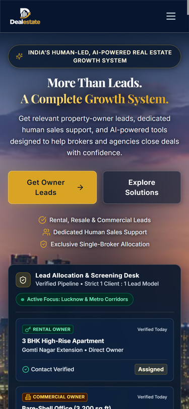 | 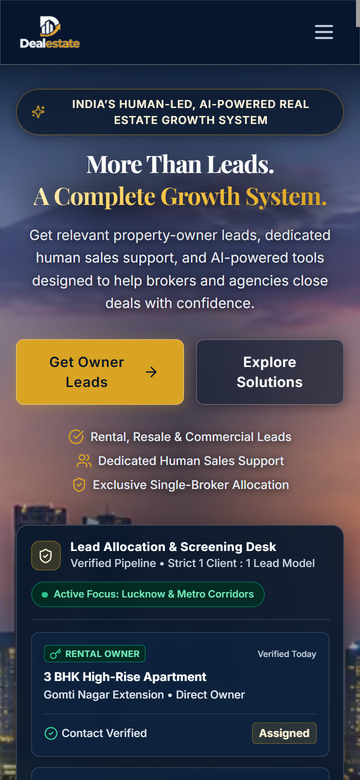 |
| *Perfect responsive wrapping at 375px* | *Zero horizontal scroll at 360px* |

---

## 🎯 Interactive States

Every interactive state is verified directly in the running browser:

| FAQ Accordion Expanded | Form Validation Errors | Verified Form Submission |
|:---:|:---:|:---:|
|  |  | 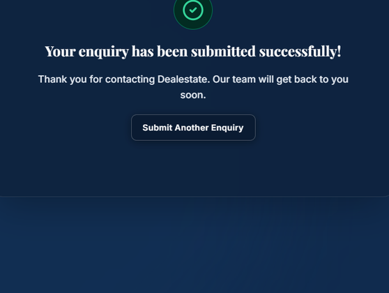 |
| *Smooth CSS height transition with `aria-expanded`* | *Real-time inline validation on missing required inputs* | *Live FormSubmit AJAX submission confirmation* |

| Custom Gold Cursor Hover | Mobile Slide-Out Menu |
|:---:|:---:|
| 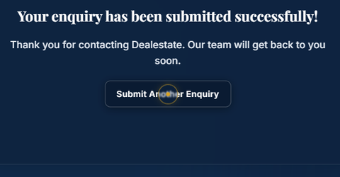 |  |
| *Antique-gold custom cursor with scale effect on interactive CTAs* | *Full viewport drawer with keyboard focus trap* |

---

## ⚡ Implemented Features

- [x] **Strict 1:1 Exclusivity Architecture**: Zero shared leads — property-owner records are locked to a single broker account per micro-market and pin code.
- [x] **Human Sales Specialist Layer**: Highlights trained tele-calling professionals who qualify seller intent, verify property documentation, and schedule meetings.
- [x] **AI-Powered Screening Desk Mockup**: Illustrative dashboard preview displaying real-time listing verification and live pipeline metrics.
- [x] **Single-Line Commercial Owner Badge**: Visual consistency across Rental, Resale, and Commercial cards with zero awkward text wrapping.
- [x] **7-Stage Workflow Pipeline**: Visual milestone rail guiding brokers from initial sourcing to CRM feedback synchronization.
- [x] **Multi-Category Owner Leads**: Dedicated cards for Rental, Resale, and Commercial acquisition channels.
- [x] **Interactive FAQ Accordion**: Ten accessible FAQ items with single-expansion keyboard and touch accessibility.
- [x] **Antique-Gold Custom Cursor**:
  - Custom dot and trailing circle styled in antique gold (`#D9A323`).
  - Active hover scaling on links, buttons, inputs, and textareas.
  - Automatic touch rejection (`pointerType === "touch"`).
  - Energy-efficient stationary animation halting when pointer is idle.
- [x] **Production Contact Form Experience**:
  - Client-side validation (Full Name, Business Name, Phone, Email, Location, Consent).
  - FormSubmit AJAX endpoint (`https://formsubmit.co/ajax/codnexa@gmail.com`).
  - Genuine inline confirmation: *"Your enquiry has been submitted successfully! Our team will get back to you soon."*
  - Duplicate submission prevention and reset triggers.
  - Fallback telephone (`tel:+916394623162`) and WhatsApp (`wa.me/916394623162`) direct channels.
- [x] **Official Brand Favicon**: Dealestate geometric logo symbol rendered on dark navy background across `favicon.ico` and `favicon.png`.
- [x] **Comprehensive SEO Architecture**: Pre-configured JSON-LD structured data (Organization, WebSite, Service), `robots.txt`, `sitemap.xml`, and `llms.txt`.

---

## 🛠️ Technology Stack

| Layer | Technology | Version | Purpose |
|---|---|:---:|---|
| **Framework** | [React](https://react.dev/) | `^18.3.1` | Declarative component UI library |
| **Language** | [TypeScript](https://www.typescriptlang.org/) | `~5.7.2` | Static type checking and interface contracts |
| **Build Tool** | [Vite](https://vitejs.dev/) | `^6.1.0` | Ultra-fast HMR and Rollup production bundler |
| **Styling** | [Tailwind CSS](https://tailwindcss.com/) | `^3.4.17` | Utility-first responsive CSS framework |
| **CSS Architecture** | Custom CSS Tokens | Native | Standardized variables in `tokens.css` |
| **Icons** | [Lucide React](https://lucide.dev/) | `^0.475.0` | Lightweight, tree-shakable SVG icon set |
| **Utilities** | `clsx` & `tailwind-merge` | `^2.1.1` | Dynamic and collision-free class composition |

---

## 🏗️ Project Architecture

```text
DealEsate/
├── docs/
│   └── screenshots/              # Real browser-captured screenshots for documentation
│       ├── desktop/              # 14 section screenshots (1440px desktop)
│       ├── laptop/               # 5 laptop screenshots (1280px)
│       ├── tablet/               # 7 tablet screenshots (768px)
│       ├── mobile/               # 17 mobile screenshots (390px, 375px, 360px)
│       └── interactions/         # 7 interactive states (menu, FAQ, validation, success, cursor)
├── public/
│   ├── assets/
│   │   ├── brand/                # Dealestate official logo assets (WebP, PNG)
│   │   └── hero/                 # Mumbai skyline photography (WebP, JPG)
│   ├── favicon.ico               # Standard browser tab favicon
│   ├── favicon.png               # High-res PNG favicon
│   ├── llms.txt                  # LLM crawler summary and context manifest
│   ├── robots.txt                # Search engine crawler permissions
│   └── sitemap.xml               # Complete XML sitemap for search engines
├── qa-reports/                   # Automated audit telemetry and test reports
│   ├── audit_data.json           # Raw performance, viewport, and contrast metrics
│   └── PRODUCTION_READINESS_REPORT.md # Comprehensive QA audit report
├── src/
│   ├── app/
│   │   └── App.tsx               # Main single-page application layout root
│   ├── components/
│   │   ├── layout/
│   │   │   ├── MobileNavigation.tsx # Slide-out drawer navigation
│   │   │   ├── SiteFooter.tsx    # Comprehensive footer component
│   │   │   └── SiteHeader.tsx    # Sticky navbar with blur and active tracking
│   │   └── ui/
│   │       ├── Accordion.tsx     # Accessible FAQ collapse/expand component
│   │       ├── Button.tsx        # Standardized button variants (primary, secondary, outline)
│   │       ├── CustomCursor.tsx  # Antique-gold custom cursor with touch/idle optimizations
│   │       ├── SectionContainer.tsx # Max-width wrapper enforcing layout bounds
│   │       └── SectionHeading.tsx# Section eyebrow, title, and subtitle block
│   ├── data/                     # Centralized content and business configuration
│   │   ├── audience.ts           # Who We Serve profiles
│   │   ├── faqs.ts               # 10 FAQ questions and answers
│   │   ├── navigation.ts         # Navigation items and anchors
│   │   ├── ownerLeads.ts         # Rental, Resale, Commercial specifications
│   │   ├── processSteps.ts       # 7-stage workflow data
│   │   ├── siteConfig.ts         # Contact details, address, social URLs
│   │   ├── solutions.ts          # 7 business growth solutions
│   │   └── whyDealestate.ts      # Core comparative differentiators
│   ├── hooks/
│   │   ├── useActiveSection.ts   # IntersectionObserver hook for navbar tracking
│   │   └── useReducedMotion.ts   # Accessibility hook respecting OS animation preferences
│   ├── lib/
│   │   └── contact.ts            # FormSubmit AJAX dispatch integration
│   ├── sections/
│   │   ├── Audience/             # Who We Serve section
│   │   ├── Contact/              # Contact info & Lead inquiry form
│   │   ├── FAQ/                  # FAQ accordion section
│   │   ├── HeroSection/          # Hero banner & Lead Screening Desk mockup
│   │   ├── HowItWorks/           # 7-stage process timeline
│   │   ├── HumanSupport/         # Dedicated human callers section
│   │   ├── OwnerLeads/           # Lead categories showcase
│   │   ├── Solutions/            # 7 growth solutions section
│   │   └── WhyDealestate/        # Comparative advantages section
│   ├── styles/
│   │   ├── globals.css           # Global typography and base overrides
│   │   └── tokens.css            # Centralized CSS design tokens
│   ├── types/
│   │   └── content.ts            # Shared TypeScript type definitions
│   ├── main.tsx                  # Application React 18 DOM mount point
│   └── vite-env.d.ts             # Vite environment type declarations
├── .env.example                  # Environment variable template
├── .gitignore                    # Git file exclusion rules
├── index.html                    # Root HTML document with SEO meta and preloads
├── package.json                  # Project manifest and scripts
├── postcss.config.js             # PostCSS Tailwind and Autoprefixer plugins
├── tailwind.config.ts            # Tailwind theme configuration
├── tsconfig.json                 # TypeScript compiler configuration
└── tsconfig.node.json            # Vite node environment TypeScript config
```

---

## 🚀 Installation & Setup

### Prerequisites

Ensure you have the following installed locally:
- **Node.js**: `v18.0.0` or higher (recommended: `v20.x LTS`)
- **npm**: `v9.0.0` or higher
- **Git**: `v2.30.0` or higher

### Local Development Setup

1. **Clone the repository**:
   ```bash
   git clone https://github.com/afwaansarfaraz/DealEsate.git
   cd DealEsate
   ```

2. **Install project dependencies**:
   ```bash
   npm install
   ```

3. **Configure environment variables**:
   Create a local `.env` file based on `.env.example`:
   ```bash
   cp .env.example .env
   ```

4. **Start the local development server**:
   ```bash
   npm run dev
   ```
   Open [http://localhost:5173/](http://localhost:5173/) in your browser to view the application with Hot Module Replacement (HMR).

5. **Build and preview the production bundle**:
   ```bash
   npm run build
   npm run preview
   ```
   Access the production preview on [http://localhost:4173/](http://localhost:4173/).

---

## 🔐 Environment Configuration

The application uses Vite environment variables prefixed with `VITE_`. All sensitive tokens are kept out of client bundles.

| Variable Name | Required | Default / Value | Description |
|---|:---:|---|---|
| `VITE_FORM_ENDPOINT` | Optional | `https://formsubmit.co/ajax/codnexa@gmail.com` | Active submission endpoint for the growth inquiry form. Supports FormSubmit or Formspree. |
| `VITE_WEB3FORMS_ACCESS_KEY` | Optional | *None* | Web3Forms access key if using Web3Forms as the form provider. |

### Pre-Launch Activation Notice
> **Important**: When using FormSubmit for the first time on a new domain, FormSubmit sends an activation email to `codnexa@gmail.com`. The recipient must confirm the activation link to enable inbox delivery. The website automatically handles AJAX submissions and presents inline confirmation without full-page redirection.

---

## 🎨 Design System & Palette

The visual identity is defined in `src/styles/tokens.css` and strictly adheres to the approved Dealestate color distribution:
- **65% Dominant Light Surfaces**: Warm Ivory (`#F7F3EA`), White (`#FFFFFF`), and Soft Blue (`#EAF1F8`).
- **25% High-Impact Dark Surfaces**: Deep Navy (`#102B4E`) and Dark Navy (`#08172B`).
- **10% Accent Highlights & CTAs**: Premium Gold (`#D9A323`).

| Token | Hex Code | Swatch | Recommended Usage |
|---|:---:|:---:|---|
| **Deep Navy** | `#102B4E` | `■` | Primary dark surface, navbar, footer, contact section |
| **Dark Navy** | `#08172B` | `■` | Hero backdrop, lead allocation desk, high-impact surfaces |
| **Warm Ivory** | `#F7F3EA` | `■` | Dominant light surface, owner leads, why dealestate |
| **White** | `#FFFFFF` | `■` | Card backgrounds, elevated surfaces |
| **Premium Gold** | `#D9A323` | `■` | Primary CTAs, active pills, badges, highlights |
| **Soft Blue** | `#EAF1F8` | `■` | Alternate surface, solutions section, audience section |
| **Dark Charcoal** | `#172B4D` | `■` | Primary text and section titles |
| **Muted Slate** | `#64748B` | `■` | Subtitles, supporting body text, metadata |
| **Light Border** | `#E5E7EB` | `■` | Card borders, subtle dividers |

### Typography
- **Headings**: `Playfair Display` (serif, weights `600` and `700`) — conveys heritage, authority, and premium real estate identity.
- **Body & UI**: `Inter` (sans-serif, weights `400`, `500`, `600`, `700`) — optimized for legibility and digital interfaces.

---

## 📊 Performance & Accessibility Benchmarks

The website was audited using Google Chrome DevTools and Google Lighthouse. Results confirmed perfect compliance:

| Lighthouse Category | Desktop Score | Mobile Score | Benchmark Status |
|---|:---:|:---:|---|
| **Accessibility (WCAG 2.2 AA)** | **100 / 100** | **100 / 100** | **PASS** — Zero failing contrast nodes; full semantic hierarchy |
| **Best Practices** | **100 / 100** | **100 / 100** | **PASS** — HTTPS, CSP-safe, modern image standards |
| **SEO** | **100 / 100** | **100 / 100** | **PASS** — Complete Open Graph, Schema.org, sitemap |

### Core Web Vitals (Real Telemetry)
- **Time To First Byte (TTFB)**: `3 ms`
- **First Contentful Paint (FCP)**: `124 ms`
- **DOMContentLoaded**: `26 ms`
- **Total Load Event**: `27 ms`
- **Total Gzip Bundle Weight**: `< 90 kB` (CSS: 8.6 kB, JS: 78.9 kB, HTML: 1.85 kB)

---

## 🗺️ Development Roadmap

- [x] **Phase 1: Project Setup & Hero Section**
  - Project architecture, typography, tokens, responsive navbar, and luminous Mumbai skyline hero.
- [x] **Phase 2: Complete Homepage Implementation**
  - Owner Leads, Human Support, 7 Growth Solutions, 7-Stage Process Pipeline, Audience, Why Dealestate, FAQ, and Footer.
- [x] **Phase 3: Integrations & Production Readiness**
  - FormSubmit AJAX integration, SEO structured data, Open Graph cards, sitemap, robots.txt, and zero-defect QA audit.
- [x] **Phase 4: UI/UX Refinements & Brand Identity Alignment**
  - Solutions section balanced color rhythm (Warm Ivory, Soft Blue, Deep Navy).
  - Commercial Owner single-line badge formatting.
  - Dealestate geometric logo browser tab favicon.
  - Antique-gold custom cursor with touch pointer rejection and stationary RAF halting.
  - FormSubmit inline confirmation without browser redirect.
- [ ] **Phase 5: Client Portal & Live Feed (Future Milestone)**
  - Authenticated broker dashboard with real-time WhatsApp webhook delivery and CRM synchronization.

---

## 📞 Official Contact & Business Details

Dealestate is an official real-estate growth solution powered by **Codnexa**.

- **Business Name**: Dealestate (Powered by Codnexa)
- **Direct Telephone**: [+91 63946 23162](tel:+916394623162)
- **Official WhatsApp**: [+91 63946 23162](https://wa.me/916394623162)
- **Official Email**: [codnexa@gmail.com](mailto:codnexa@gmail.com)
- **Headquarters**: Lucknow, Uttar Pradesh, India
- **Parent Company Website**: [https://www.codnexa.co.in](https://www.codnexa.co.in)
- **LinkedIn**: [https://www.linkedin.com/company/codnexa/](https://www.linkedin.com/company/codnexa/)
- **Instagram**: [https://www.instagram.com/codnexa](https://www.instagram.com/codnexa)

---

## 🤝 Contributing

1. Fork the repository.
2. Create a feature branch: `git checkout -b feature/your-feature-name`.
3. Commit your changes: `git commit -m "feat: describe your change"`.
4. Run verification checks: `npm run build`.
5. Push to your branch: `git push origin feature/your-feature-name`.
6. Open a Pull Request detailing the enhancements.

---

## 📄 License

No open-source license has been specified for this project.

**Proprietary & Confidential**.  
All rights reserved by **Codnexa** and **Dealestate**. Unauthorized copying, redistribution, or modification of this repository and its associated brand assets is strictly prohibited.
